<div align="center">

<picture>
  <source media="(prefers-color-scheme: dark)" srcset="./assets/seal-print-dark.svg">
  
</picture>

### Free Open Source Assembly Software

Competitive cloud/backend infrastructure, written in assembly, with exceptional performance for any
platform or container.

**[asmfoundation.github.io](https://asmfoundation.github.io/)**

[Projects](https://asmfoundation.github.io/projects/) &nbsp;&nbsp; [Benchmarks](https://asmfoundation.github.io/benchmarks/) &nbsp;&nbsp; [Architecture](https://asmfoundation.github.io/architecture/) &nbsp;&nbsp; [Get started](https://asmfoundation.github.io/get-started/) &nbsp;&nbsp; [Docs](https://asmfoundation.github.io/docs/)

</div>

---

<!--
  The drawing below is the website's Architecture page. The site build in AsmFoundation/AsmFoundation writes it
  from site/data/architecture.json to https://asmfoundation.github.io/architecture/drawing.svg, and this page
  shows that file. Change the drawing there, never here: it updates on this page after the next build.
-->
<a href="https://asmfoundation.github.io/architecture/"></a>

| Project | What it is | State |
|---|---|---|
| **[KvAsm](https://github.com/AsmFoundation/KvAsm)** | A gRPC key-value server | **0.3.0** |
| **[GrpcAsm](https://github.com/AsmFoundation/GrpcAsm)** | A gRPC server and client that runs your C# service class | in&nbsp;development |
| **[AsmSdk](https://github.com/AsmFoundation/AsmSdk)** | Assembly projects on MSBuild and NuGet, for Windows, Linux and macOS on x64 and ARM64, and WebAssembly | **0.3.0** |
| **[HttpAsm](https://github.com/AsmFoundation/HttpAsm)** | HTTP/1.1, /2 and /3, written from the RFCs | in&nbsp;development |
| **[AsmClaudeMarketplace](https://github.com/AsmFoundation/AsmClaudeMarketplace)** | Claude Code plugins for this ecosystem | asmsdk **0.3.0** |
| **StorageAsm** | Object storage over gRPC | in design |

The measurements, one core first, are on the [Benchmarks](https://asmfoundation.github.io/benchmarks/)
page, each with the run behind it.

### Try it

```sh
docker run --rm -p 50051:50051 ghcr.io/asmfoundation/kvasm:0.3.0
```

```json
{ "msbuild-sdks": { "AsmFoundation.Sdk": "0.3.0" } }
```

The whole session, step by step: [Get started](https://asmfoundation.github.io/get-started/).

### Get involved

Issues and pull requests are welcome in every repository:
[CONTRIBUTING.md](https://github.com/AsmFoundation/.github/blob/main/CONTRIBUTING.md) says what a change
needs, and a performance change needs a paired measurement. Report vulnerabilities privately
([SECURITY.md](https://github.com/AsmFoundation/.github/blob/main/SECURITY.md)). Every project is
Apache-2.0.
