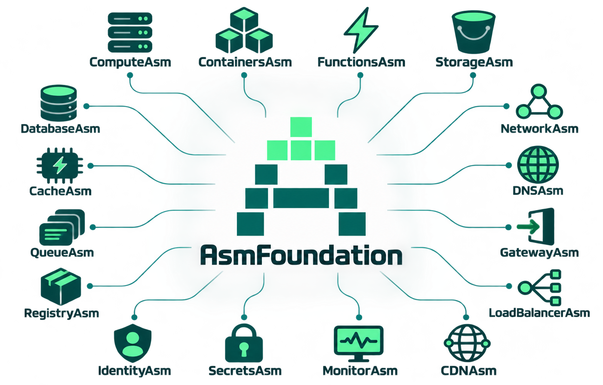

<div align="center">

<picture>
  <source media="(prefers-color-scheme: dark)" srcset="./assets/panel-dark.png">
  
</picture>

### Cloud backend infrastructure, hand-written in x86-64 assembly.

**FOSAS: Free Open Source Assembly Software.** Apache-2.0. Measured, not argued.

</div>

---

The AsmFoundation builds competitive backend services in hand-written NASM:
key-value stores, RPC, storage, and the rest of the map above.

- **Tiny containers:** they run in Linux containers measured in megabytes
  (KvAsm's whole image is 2 MB).
- **Modern packaging:** container images, NuGet packages, .NET clients.
- **Evidence:** every public performance claim comes with the measurement
  behind it.

## Projects

| Project | What it is | Status |
|---|---|---|
| **[KvAsm](https://github.com/AsmFoundation/KvAsm)** | A gRPC key-value server in x86-64 assembly. Its HTTP/2 engine, HPACK decoder, gRPC layer and protobuf codec are all hand-written: to our knowledge, the first gRPC server written in assembly. **8.84M GET/s on 4 cores, 2.29–3.68× Redis, Valkey, Dragonfly, Garnet and Memcached** on small-value reads ([evidence and scope](https://github.com/AsmFoundation/KvAsm/blob/main/docs/CLAIMS.md)). h2spec 146/146; ships as a 2 MB `FROM scratch` image. | **0.3.0**: [image](https://github.com/orgs/AsmFoundation/packages/container/package/kvasm), [`KvAsm.Client`](https://www.nuget.org/packages/KvAsm.Client) |
| **[AsmSdk](https://github.com/AsmFoundation/AsmSdk)** | Enterprise-grade project, dependency and build management for assembly, on MSBuild and NuGet. An `.asmproj` sits next to `.csproj` in one solution and builds with `dotnet build`. Asm libraries are versioned NuGet packages, consumed with `PackageReference`. The NASM + LLVM toolchain is restored like any package, so there is nothing to install. | **0.1.0**: [docs](https://asmfoundation.github.io/AsmSdk/), [`AsmFoundation.Sdk`](https://www.nuget.org/packages/AsmFoundation.Sdk) |
| **[AsmClaudeMarketplace](https://github.com/AsmFoundation/AsmClaudeMarketplace)** | Claude Code plugins for this ecosystem, one per topic. `asmsdk` teaches Claude AsmSdk end to end, with facts verified against the real SDK, a 31-check linter, and an evaluation in which, with the plugin, 12 of 12 agent-written projects built and passed their checks against the real SDK, compared with 4 of 12 without it. | **asmsdk 0.1.0**: `/plugin marketplace add AsmFoundation/AsmClaudeMarketplace` |
| **[GrpcAsm](https://github.com/AsmFoundation/GrpcAsm)** | A gRPC server **and client** in assembly: KvAsm's engine, made general. Zero-copy handlers, with NASM, C, .NET and Python APIs. | **in development**: the server engine and its C API (`libgrpcasm.so`) work, and CI checks them with h2spec and grpc-dotnet; not released yet |
| **StorageAsm** | Blob/S3-style object storage over gRPC on an assembly server: local NVMe devices and remote stores behind one API. | in design |

## The map

The panel above is where this is going: compute, containers, functions,
storage, databases, networking, DNS, caches, queues, gateways, registries,
load balancers, identity, secrets, monitoring and CDN, each one an
`<Something>Asm` service. Only what is listed under **Projects** exists today.
The rest is the plan.

## How we build

- **Measured, not argued.**
  - When a design has a rival, a paired benchmark picks the winner.
  - Every public performance claim is recorded in a claims ledger with its
    evidence and its scope, including what is deliberately *not* claimed.
- **Assembly where it pays.** Hand-written NASM for x86-64 Linux, using SIMD,
  AES-NI and carry-less multiply (VPCLMULQDQ) where profiles show they pay, and
  plain code everywhere else.
- **Tested like a protocol implementation.**
  - Standard conformance suites (h2spec);
  - fuzzing on every build;
  - differential tests against reference implementations;
  - end-to-end suites against the real container image.
- **Enterprise plumbing:**
  - Semantic Versioning and changelogs;
  - CI on every push;
  - NuGet packages published through trusted publishing (OIDC, no stored keys);
  - minimal `FROM scratch` images;
  - private vulnerability reporting on every repository.
- **Native code that fits a modern stack.**
  - With [AsmSdk](https://github.com/AsmFoundation/AsmSdk), assembly projects
    build, version and ship through MSBuild and NuGet, like any other project.
  - Services come with .NET clients.

## Try it

Run KvAsm and talk to it from .NET:

```sh
docker run --rm -p 50051:50051 ghcr.io/asmfoundation/kvasm:0.3.0
dotnet add package KvAsm.Client
```

```csharp
using KvAsm.Client;

using var kv = new KvAsmClient(new Uri("http://localhost:50051"));
await kv.PutAsync("user:42", "Ada");
string? name = await kv.GetStringAsync("user:42");   // "Ada"
```

Build assembly with AsmSdk ([getting started](https://asmfoundation.github.io/AsmSdk/guide/getting-started.html)).
Name the SDK in `global.json`; restore downloads it and its toolchain from
nuget.org:

```json
{ "msbuild-sdks": { "AsmFoundation.Sdk": "0.1.0" } }
```

Then write `Hello/Hello.asmproj`. Every `*.asm` next to it becomes part of
`bin/Debug/libhello.so`:

```xml
<Project Sdk="AsmFoundation.Sdk">
  <PropertyGroup>
    <AsmLibraryName>hello</AsmLibraryName>
  </PropertyGroup>
</Project>
```

## Get involved

- **Issues and pull requests are welcome** in every repository.
  [CONTRIBUTING.md](https://github.com/AsmFoundation/.github/blob/main/CONTRIBUTING.md)
  lists what a change needs, and a repository's own guide adds its build and
  test commands. A performance change needs a paired measurement, not an
  argument.
- **Security:** report vulnerabilities privately, through the repository's
  **Security → Report a vulnerability** form
  ([SECURITY.md](https://github.com/AsmFoundation/.github/blob/main/SECURITY.md)),
  never in a public issue.
- **License:** every project is Apache-2.0.
